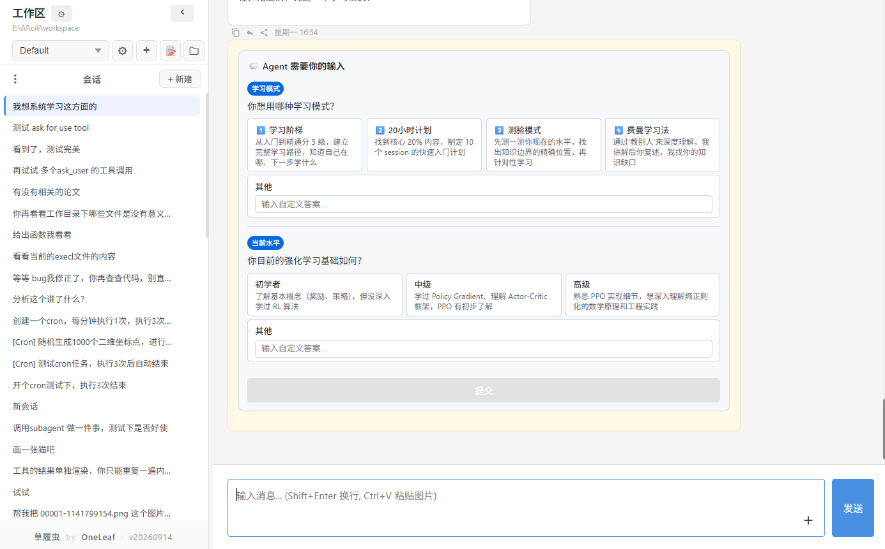
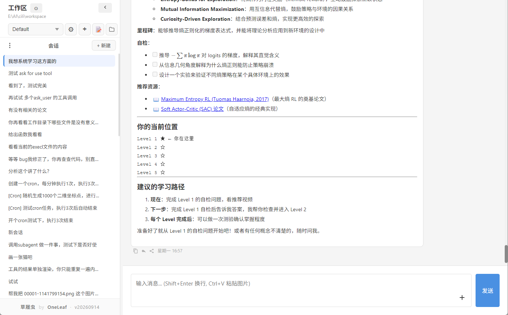
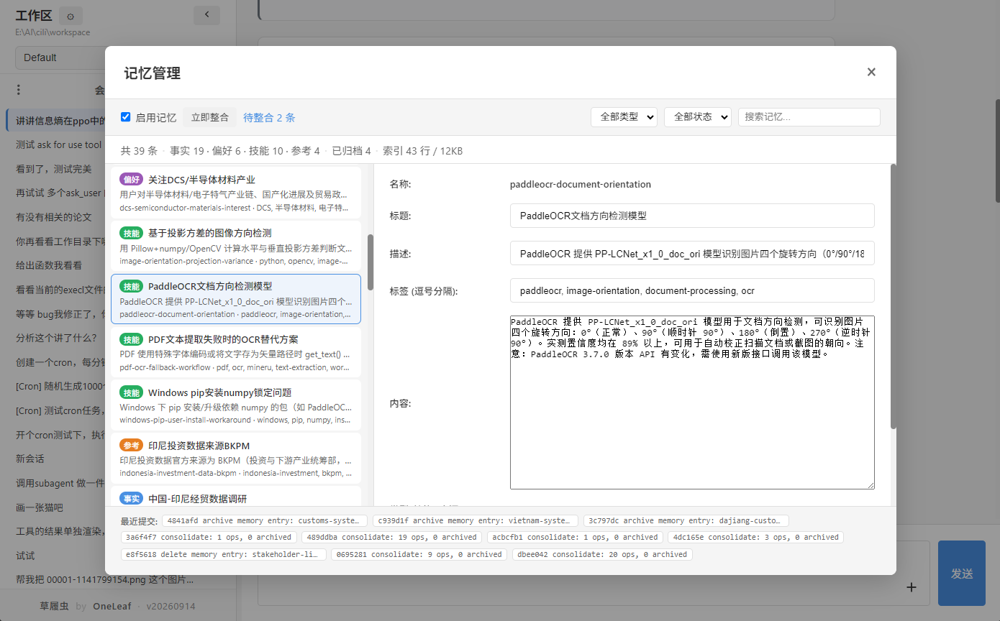

<div align="center">

# 草履虫 Cili Agent

**Agent Harness · 多端接入 · 浏览器自动化 · 学习工作一体 · 开箱即用**


[](https://www.python.org/)
[](https://fastapi.tiangolo.com/)
[](https://playwright.dev/)
[](test/)
[](LICENSE)

</div>

---

Cili 是一个**自托管的 Agent Harness**，提供完整的智能体运行时：工具系统、会话管理、浏览器自动化、定时任务。将大模型转化为可编排、可扩展、可自动化的执行引擎，并可通过 Web、QQ 机器人、个人微信与同一个 Agent 对话。

## 为什么是草履虫

草履虫是自然界最简单的多细胞生物之一——结构精简，但功能完备。本项目以此为名，追求同样的哲学：**架构干净、依赖极少、开箱即用**。

- **角色化多模型架构** — Master/Worker/Lite 三角色共享同一 Agent 类，可分别指定模型；Full Compact 用 LLM 摘要旧消息，Lite 模型跑记忆提取与整合，各司其职
- **浏览器自动化** — Playwright 驱动，支持 Chrome / Edge，全局单例管理，网页搜索与内容抓取
- **文档解析** — 内置 MinerU 支持，PDF / Word / PPT / 图片等格式智能识别并转 Markdown
- **LaTeX 支持** — 内置 LaTeX 编译器，支持生成论文级别的 PDF 文档
- **内置学习引擎** — 参考艾宾浩斯遗忘曲线设计，六种学习模式（学习阶梯、20小时计划、测验、速查表、资源筛选、费曼学习法）。说一句"我想学习 XXX"即可启动结构化学习

  <details>
  <summary>学习模式截图</summary>

  

  

  </details>

- **内置调研引擎** — 只采信官方文档和一手来源，自动过滤自媒体和二手解读。说"帮我查查 XXX"即可启动，输出带完整引用链的 Markdown 报告
- **用户画像 / 偏好记忆** — 自动学习你的沟通风格和偏好，按工作区沉淀为 preference 记忆条目并常驻注入，让 Agent 更懂你的表达习惯和决策方式
- **长期记忆** — 跨会话知识存储与技能复用，避免重复搜索和学习

  <details>
  <summary>记忆管理截图</summary>

  

  </details>
- **多端接入** — Web 之外，QQ 官方机器人（WebSocket 长连接、单条流式消息、被动回复配额）与个人微信（iLink 协议、扫码登录、工具进度节拍）都能与同一个 Agent 对话；多端共享同一会话，在设置页扫码或填凭据即用
- **Windows 专属** — 针对 Windows 优化，Git Bash 执行 Shell，双击即可运行

## 快速开始

### 前置条件

- **Windows 10/11**（目前仅支持 Windows）
- 无需手动安装 Python、Git Bash 或 PowerShell 7 — 启动脚本自动处理

### 启动

```bash
# 方式一：双击启动（自动检测/下载依赖）
start.cmd

# 方式二：PowerShell 指定端口
start.ps1 --port 8080

# 方式三：直接运行（需要 Python 在 PATH 中）
python main.py
python main.py --port 8080 --host 0.0.0.0
```

启动后浏览器自动打开 `http://localhost:1618`；端口被占用时，若占用者是旧 cili 实例则自动停止它并复用端口，否则顺延到下一个可用端口。

### 配置

首次启动时通过 Web UI 配置 LLM 模型：

| 参数 | 说明 | 默认值 |
|------|------|--------|
| `model.name` | Master 主模型（所有角色默认继承） | `claude-sonnet-4-6` |
| `model.interface_type` | API 协议 | `anthropic` |
| `model.api_key` | API 密钥 | — |
| `model.base_url` | API 端点 | `https://api.anthropic.com` |
| `worker_model.name` | Worker 模型（可选，只填 name 则其余继承 Master） | — |
| `lite_model.name` | Lite 模型（可选，只填 name 则其余继承 Master） | — |

支持环境变量覆盖：`ANTHROPIC_API_KEY`、`ANTHROPIC_BASE_URL`、`ANTHROPIC_MODEL`。

## 自动升级

### 启动时自动升级（默认开启）

服务启动后，后台线程自动检查 GitHub 最新版本（版本号取自 `web/static/version.json`），发现新版本即自动下载代码包并覆盖本地代码，保留 `data/`、`workspaces/`（及旧 `workspace/`）、`.git` 目录。下载优先 GitHub 直连，失败自动回退国内镜像。如需关闭，在 `setting.json` 中设置 `system.auto_update=false`。

### 命令行升级

```batch
# 批处理版本
scripts\upgrade.cmd

# PowerShell 版本
.\scripts\upgrade.ps1
```

升级脚本会自动：
- 从 GitHub 或镜像下载最新代码 ZIP（默认 GitHub 直连，自动回退 ghfast.top / ghproxy.net / gh-proxy.com 国内镜像）
- 解压并覆盖本地文件（保留 `data/`、`workspaces/`、旧 `workspace/` 目录）
- 新增/更新的文件会用 `[+]` / `[~]` 标记
- 升级完成后重启服务即可

## 核心能力

### Agent 架构

**统一 SessionRunner + JSON 角色配置**：Master/Worker/Lite 是同一个 `SessionRunner` 的三个角色（`BaseSessionRunner` 是组合根），行为差异全部由 `core/agents/{role}.json` 驱动（工具白名单、行为开关、system prompt 块、user 层）。全角色流式输出，可随时中断。

```
SessionRunner (统一类，role 分叉)
  ├── master   (interactive) 全量工具：读写/图片、Shell/PowerShell、Python、浏览器、搜索、记忆、
  │             定时任务、Todo、LaTeX、PDF 转换、技能、委派 agent、ask_user、工作流、发文件等
  ├── worker   (autonomous) master 去掉 ask_user/cron/send_user_file/workflow；
  │             保留浏览器、LaTeX、Todo、委派 agent，适合批量后台任务
  └── lite     (autonomous) 仅 read/write/edit/bash/python/clock/message_bus，最小自主执行
```

**统一工具/skill 注册表**：`core/tools/` 所有工具平铺，`registry.py` 按角色 JSON 的白名单实例化；`core/skills/` 每个技能一个目录（`skill.md`），frontmatter `roles` 声明适用角色。

### LLM 底层架构

Provider 无关的 Adapter 分层设计：

```
Message → Adapter.serialize() → HTTP (httpx) → API → Adapter.parse() → ContentBlock
                                  ↓
                           HttpTransport (SSE / 重试 / 背压)
                                  ↓
                           BlockAssembler (流式累积)
```

- **统一流式协议**：8 种 StreamChunk 类型，所有 Provider 通过 Adapter 翻译
- **自动重试**：429/5xx 指数退避 + 抖动，支持 `Retry-After` 头
- **供应商预设**：`core/llm/server_presets.py` 内置 anthropic/openai/deepseek/glm/kimi/litellm 等网关的 base_url 与鉴权头
- **延迟解析**：`ToolCallBlock.arguments` 保留原始 JSON，执行时才解析

### 浏览器自动化

```
BrowserService (模块级单例)
  ├── 专用工作线程（解决 Playwright greenlet 线程绑定）
  ├── Tab 池管理（自动清理空闲标签页）
  ├── 嵌套调用检测（避免死锁）
  └── Chrome 延迟启动（首次操作时才创建进程）
```

- 网页搜索：支持 Bing 和 Google 双引擎
- 网页抓取：Playwright 渲染 + 智能内容提取
- 全局唯一 Chrome 进程，会话间复用

### 会话与持久化

- 每个会话独立目录（8 位十六进制 ID）
- 原子写入（临时文件 + `Path.replace()`）
- 消息三级压缩：Microcompact → Full Compact → 紧急 Body Size
- Worker/Lite 执行日志实时保存，前端懒加载
- 支持多工作区隔离（sessions、cwd、配置）
- 工作区目录可整体或单独迁移到其他盘（工作区设置 → 数据迁移）：同卷秒级、跨卷复制校验，中断可恢复；迁移前自动备份 `setting.json` / `workspaces.json`

### 长期记忆

跨会话的知识存储与技能复用系统（v3）：

- **四类条目**：fact / preference / skill / reference，Markdown 存储，按工作区隔离
- **提取流水线**：会话回合结束后后台提取记忆候选写入 journal；提取失败降级为 `[RAW]` 原文，绝不丢内容
- **整合流水线**：每 2 小时（或手动「立即整合」）由 Lite 模型把 journal 待整合记录转成条目，刷新全局摘要，推进游标并 git 提交
- **记忆管理 UI**：记忆总览、按类型/状态/关键词过滤、查看/归档/恢复/删除条目、手动整合按钮、记忆功能开关
- **容错设计**：journal 按 key 去重保证恰好一次；游标单调推进、崩溃可安全重跑；幻觉 op 自动容错不阻塞队列

### 定时任务 (Cron)

通过对话创建和管理定时任务：

```python
# 每 60 分钟执行
cron(action="create", schedule={"type": "interval", "minutes": 60}, task="检查服务器状态")

# Cron 表达式
cron(action="create", schedule={"type": "cron", "expr": "0 9 * * *"}, task="每日晨报")

# 限制执行次数
cron(action="create", schedule={"type": "interval", "minutes": 5}, task="导入文件", max_executions=100)
```

- 内置种子任务（`core/cron_seeds/`）+ 用户级任务（对话或面板创建，数据在 `{workspace}/.cili/cron/`）
- 状态持久化，重启后自动恢复调度
- 同一 workspace 串行执行，避免并发冲突
- **remaining 计数器**：每次执行自动递减，到 0 时任务自动 disable（硬保证）
- **max_executions 参数**：创建任务时可设置最大执行次数（1-9999，默认 9999）

### 技能系统

每个技能一个目录（`skill.md`，YAML frontmatter 声明名称/描述/适用角色），按角色注入 system prompt。大型技能把过程性内容拆到目录内 `references/*.md` 子文件，`skill.md` 只留触发描述、核心规则和阶段索引，按阶段用 `skill(action='read', ..., file=...)` 懒读取（如 `win-ops`、`file-processing`）：

| 技能 | 适用角色 | 说明 |
|------|---------|------|
| code-review | master | 代码审查 |
| task-delegation | master/worker | 任务拆分与委派 |
| research | master | 深度研究（委托 Worker，只采信一手来源） |
| learning | master | 结构化学习助手 |
| courseware | master/worker | 课件生成（单文件 HTML：幻灯片/讲稿/测验/错题，按章节或错题类型） |
| textbook | master/worker | 中小学教材知识库（1300+ 本，按章节懒加载） |
| news | master | 热点新闻聚合（热搜/早报/金价汇率/科技资讯） |
| grilling | master | 推敲（多轮追问、压力测试方案） |
| translate-large-document | master | 大文档翻译（分块 + Worker 委派） |
| generate-agents-md | master/worker | 扫描项目代码结构，生成 AGENTS.md 项目指令文件 |
| mermaid-diagram | master/worker/lite | Mermaid 图表生成（流程图、架构图、时序图、脑图、ER图等） |
| tikz-diagram | master/worker/lite | TikZ 科学绘图（LaTeX/PGFplots 出版级图表） |
| iso-figure | master/worker | 等轴测立体结构图（Three.js 单页离线 HTML，可导出 PNG/PDF） |
| context-bounded-processing | worker | 上下文受限处理 |
| file-processing | master/worker/lite | 文件处理与文档解析 |
| word | master/worker/lite | Word 文档处理（docx/doc 读取、创建、编辑、转换） |
| excel | master/worker/lite | Excel 表格处理（xlsx/xls 读取、公式、格式化） |
| powerpoint | master/worker/lite | PPT 演示文稿处理（pptx/ppt 创建、编辑、视觉检查） |
| pdf | master/worker/lite | PDF 处理（提取、合并拆分、OCR、转 Word） |
| win-ops | master/worker | Windows 本机体检（只读采集 + 阈值评估，Markdown 报告；分级修复需确认） |

## 项目结构

```
cili/
├── start.cmd / start.ps1       # 启动入口（自动环境检测；便携模式把依赖下载到 data/deps）
├── main.py                     # Python 入口（uvicorn web server）
├── cli.cmd                     # 终端客户端入口（进程外客户端，cwd 即 workspace）
├── requirements.txt            # 运行时依赖（main.py 启动时安装）
├── .ruff.toml                  # lint 配置
├── .github/workflows/ci.yml    # GitHub Actions：Windows 3.11/3.12 全量测试 + ruff
├── scripts/
│   ├── upgrade.cmd             # Windows 批处理升级脚本
│   └── upgrade.ps1             # PowerShell 升级脚本
├── core/                       # 领域与运行时（接口无关）
│   ├── app_context.py          # 全局单例的 startup/shutdown（组装根）
│   ├── session_runner.py       # 统一 SessionRunner（master/worker/lite 角色分叉）
│   ├── base_session_runner.py  # runner 组合根与转发层（循环/压缩在 session_runner_runtime/）
│   ├── session_registry.py     # runner 池 + 运行权认领
│   ├── output_sink.py          # 接口无关的输出接收端
│   ├── role_config.py + agents/# 角色 JSON：工具白名单/行为开关/system prompt 块
│   ├── prompt_builder.py       # system prompt 块拼装 + user 层注入
│   ├── config.py               # 配置加载（providers + agents 两级模型配置）
│   ├── session.py              # 会话存储（JSON 持久化、过滤、usage 追踪）
│   ├── compression.py          # 三层消息压缩（Microcompact / Full Compact / Emergency）
│   ├── llm/                    # LLM Adapter 分层（Anthropic / OpenAI / Responses、传输/重试）
│   ├── tools/                  # 工具层（统一注册表，按角色白名单实例化）
│   ├── skills/                 # 内置技能（skill.md + roles frontmatter）
│   ├── security/               # 权限规则、路径策略、审批判定
│   ├── memory_*.py             # 长期记忆（存储 / 摄入日志 / 提取整合）
│   ├── cron/ + cron_seeds/     # 定时任务子系统 + 全局种子任务
│   ├── workflows/              # 工作流子系统
│   ├── mail/ + org/ + textbooks/ + office_pdf/   # 邮件原语 / 组织托管 / 教材 / Office→PDF
│   └── templates/              # 提示词、学科教练、教材数据包索引
├── interfaces/                 # 服务端接入端（与 Web 共享会话与 runner）
│   ├── common/                 # 共享层：账号状态/指令骨架/媒体校验/回合准入
│   ├── email/                  # 邮件接入端（IMAP + SMTP，多账号，白名单默认拒绝）
│   ├── qq/                     # QQ 接入端（官方机器人，单条流式消息，多账号）
│   └── wechat/                 # 微信接入端（iLink 个人微信，长轮询，多账号）
├── clients/
│   └── cli/                    # 终端客户端（进程外，HTTP + SSE，cwd 即 workspace）
├── web/                        # Web 接口层
│   ├── web_api.py              # FastAPI 装配入口（lifespan/中间件/静态文件/路由）
│   ├── routes_*.py             # 各资源域路由
│   ├── deps.py / sse.py / profile.py   # 共享依赖 / SSE 适配 / 接入端能力档案
│   └── static/                 # 前端（index/session、app/chat、file-tree、各类设置页等）
├── docs/                       # 设计文档
├── test/                       # pytest 测试（190+ 文件）
└── workspaces/                 # 工作区集合（default/ 为默认；旧 workspace/ 启动时自动迁入）
```

## 测试

```bash
# 运行全部测试
python -m pytest test/ -v

# 运行单个测试文件
python -m pytest test/test_bash_tool.py -v

# 运行带覆盖率的测试（需先 pip install pytest-cov）
python -m pytest test/ --cov=core --cov-report=term-missing
```

测试覆盖：SessionRunner（master/worker/lite 三角色）、LLM Adapter/Transport、统一工具/技能系统、Session/压缩、Config、BrowserService、Cron、Workflow、Web API、QQ/微信/邮件接入端等核心模块。

## 设计文档

完整的架构设计文档见 [docs/](docs/) 目录：

| 文档 | 内容 |
|------|------|
| [session-runner-design.md](docs/design/session-runner-design.md) | Agent 架构、循环机制、消息管理 |
| [content-block-design.md](docs/design/content-block-design.md) | LLM 底层：Adapter 分层、ContentBlock 类型、StreamChunk 协议 |
| [compression-design.md](docs/design/compression-design.md) | 三层消息压缩：Microcompact、Full Compact、Emergency |
| [tool-system-design.md](docs/design/tool-system-design.md) | 统一工具注册表、执行流程、全部工具说明 |
| [session-management-design.md](docs/design/session-management-design.md) | 会话存储、消息过滤、自动压缩 |
| [browser-service-design.md](docs/design/browser-service-design.md) | BrowserService 单例、工作线程、Tab 池 |
| [cron-scheduler-design.md](docs/design/cron-scheduler-design.md) | Cron 调度器、任务配置、执行机制 |
| [memory-system-design.md](docs/design/memory-system-design.md) | 长期记忆：知识存储与技能复用 |
| [web-api-design.md](docs/design/web-api-design.md) | REST API、SSE 流式、前端架构 |
| [todo-write-design.md](docs/design/todo-write-design.md) | TodoWrite 任务规划：整表替换、三态状态 |
| [system-prompt-design.md](docs/design/system-prompt-design.md) | 系统提示词构建逻辑 |
| [environment-setup-design.md](docs/design/environment-setup-design.md) | Python 环境初始化、embeddable 模式 |
| [qq-interface-design.md](docs/design/qq-interface-design.md) | QQ 接入端：官方机器人、单条流式消息、被动回复配额 |
| [wechat-interface-design.md](docs/design/wechat-interface-design.md) | 微信接入端：iLink 协议、扫码登录、进度节拍、context_token 预算 |
| [llm-api-reference.md](docs/design/llm-api-reference.md) | LLM API 参考文档 |
| [settings-guide.md](docs/settings-guide.md) | 配置项说明（模型、角色模型、鉴权、MinerU 等） |

## 技术栈

| 组件 | 技术 | 说明 |
|------|------|------|
| Web 框架 | FastAPI + Uvicorn | 异步 ASGI 服务器 |
| HTTP 客户端 | httpx | 连接池、SSE、自动重试 |
| 浏览器自动化 | Playwright | CDP 连接 Chrome |
| 前端 | 原生 HTML/CSS/JS | 零框架依赖，轻量快速 |
| 数学渲染 | MathJax | LaTeX 公式支持 |
| Markdown | marked.js | 消息 Markdown 渲染 |
| 消息接入端 | qqbot-agent-sdk / httpx | QQ 官方机器人 SDK；微信 iLink 协议直连（扫码登录、AES 媒体加密） |

## 完整使用指南

含全部截图和功能说明：[使用指南 →](docs/usage-guide.md)

## 许可证

本项目基于 [MIT License](LICENSE) 开源。

---

<div align="center">

**草履虫** — 结构精简，功能完备

*by OneLeaf*

</div>
